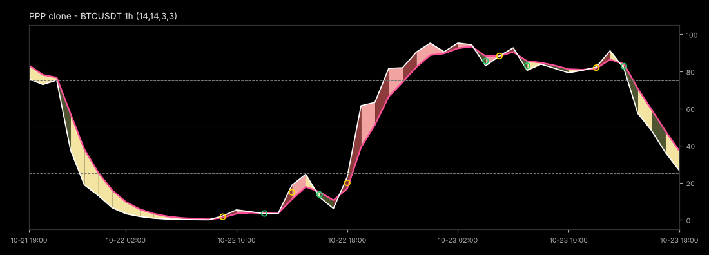
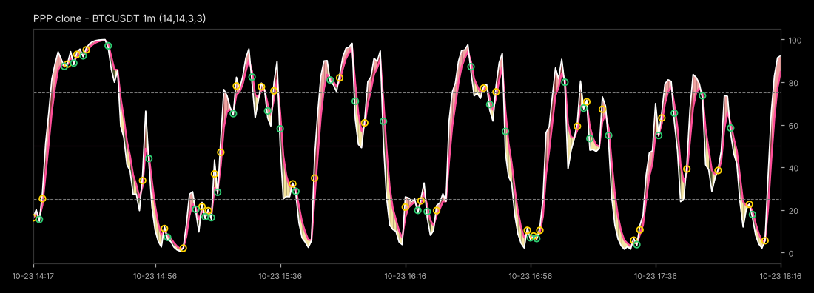

# PPP 재현 오실레이터 (PPP Clone)

「직장인도 쉽게 사용 가능한 PPP지표 사용법」(핑퐁팽) 문서의 그림과 설명만 보고 만든 TradingView Pine Script v6 재현본과, 문서의 매매 규칙을 실제 데이터로 검증한 결과입니다.

> ⚠️ 원본 PPP 지표는 비공개(초대 전용) 스크립트입니다. 계산식과 설정값이 공개되지 않아 이 코드는 **추정 재현본**이며 원본과 같다는 보장이 없습니다. 매매 추천이 아닙니다.

| 파일 | 내용 |
|---|---|
| [`ppp-oscillator.pine`](ppp-oscillator.pine) | 지표: K/D 두 선, 띠 색 4가지, 25·50·75 기준선, 크로스 표시, 4P 진입 신호(가격 차트), 알림 |
| [`ppp-4p-strategy.pine`](ppp-4p-strategy.pine) | 전략: 같은 계산 + 문서의 진입·익절·손절 규칙 (TradingView 전략 테스터용) |
| [`verify/`](verify) | 같은 규칙의 Python 구현, 데이터 다운로드, 검증 실행 스크립트, 결과(`results.json`) |

## 재현한 계산식

문서 2쪽: 추세 방향 → 상대강도(RSI) → 추세 필터링(EMA) → 모멘텀 가속도

```
RSI(14) → RSI의 스토캐스틱(14) → EMA(3) = K(흰 선) → EMA(3) = D(분홍 선)
띠 색: K ≥ D 이고 |K−D| 커짐 = 강세 확장, 작아짐 = 강세 유지·둔화
       K < D 이고 |K−D| 커짐 = 약세 확장, 작아짐 = 약세 유지·둔화
강한 크로스: 골든크로스 지점 ≤ 25, 데드크로스 지점 ≥ 75
```

넓게 보면 Stochastic RSI이고, 스무딩만 SMA 대신 EMA를 씁니다. 설정에서 SMA로 바꾸면 TradingView 기본 Stoch RSI와 같아집니다.



문서 3·5쪽 그림은 3시간 간격 눈금, 약 13시간 주기의 파동으로 보아 1시간봉 화면으로 추정됩니다. 위 그림은 같은 1시간봉에 재현본을 그린 것입니다. 아래는 문서가 매매에 쓰라고 한 1분봉 화면입니다. 4시간 동안 크로스가 수십 번 납니다.



> 그림은 TradingView 캡처가 아닙니다. 바이낸스 실제 시세로 같은 계산을 적용해 TradingView 다크 테마처럼 그린 것입니다.

## 4P 규칙 (문서 8~10쪽 → 코드)

| 단계 | 문서 | 코드 |
|---|---|---|
| 1P 방향 | 1시간봉 장기 이평 정배열/역배열 | 직전 확정 1시간봉 EMA 60 > 120 > 240이면 롱만, 반대면 숏만 |
| 2P 자리 | 장기 이평(60·120·240) 터치 | 최근 5봉 안에 봉 범위가 EMA에 닿았고, 종가가 그 EMA 위(롱)/아래(숏) |
| 3P 신호 | 막 난 PPP 크로스 | 교차한 그 봉. 25 이하/75 이상은 강한 크로스, 25~75는 2P와 겹칠 때만 |
| 확정 | 봉 마감 후 진입 | 봉 마감 시 시장가 (`process_orders_on_close`) |
| 익절 | 다음 자리·저항(볼밴 상단)·반대 크로스 중 먼저 | 볼린저밴드(20, 2) 지정가 또는 반대 크로스 시 종가 |
| 손절 | 현재 장기 이평 이탈(롱)·돌파(숏) | 진입 근거 EMA를 종가가 0.05% 넘게 벗어나면 종가 청산 |

4P의 "중첩 근거(다이버전스·패턴·거래량)"는 문서에 판단 기준이 없어 넣지 않았습니다.

## 검증 결과

**데이터**: 바이낸스 현물 1분봉, BTC·ETH·SOL·XRP·DOGE / USDT, 2026-08-09 ~ 2026-10-23 (75일). 앞의 20일은 1시간봉 EMA240 워밍업으로 쓰고 **2026-08-29 ~ 10-23 (55일)**만 평가했습니다. 수수료는 편도 0.05%(선물 시장가)입니다.

### 1) 4P 전체 규칙 백테스트

| 종목 | 거래 수 | 하루 평균 | 승률 (수수료 전) | 승률 (수수료 후) | 손익비(PF, 수수료 후) | 55일 누적 |
|---|---:|---:|---:|---:|---:|---:|
| BTCUSDT | 2,030 | 36.9 | 42.6% | 4.8% | 0.03 | −87.4% |
| ETHUSDT | 2,616 | 47.6 | 40.5% | 7.3% | 0.05 | −93.8% |
| SOLUSDT | 2,621 | 47.7 | 41.5% | 11.1% | 0.09 | −93.6% |
| XRPUSDT | 2,135 | 38.8 | 41.5% | 12.3% | 0.12 | −89.7% |
| DOGEUSDT | 2,380 | 43.3 | 39.3% | 13.3% | 0.13 | −92.0% |

- 평균 보유 2.8봉(약 3분)입니다. 청산 이유는 반대 크로스 59%, 볼린저밴드 익절 39%, EMA 손절 2%입니다.
- **수수료가 0이어도 손익비는 0.86**으로 손실입니다. 지표 신호 자체에 우위가 없습니다. 게다가 수익 거래의 평균 폭(수수료 전 +0.076%)이 왕복 수수료(0.1%)보다 작아서 이긴 거래도 대부분 수수료 후 손실이 됩니다.

### 2) 설정을 바꿔도 결론이 같은지 (5종목 합산, 수수료 0 / 0.02% / 0.05%)

| 설정 (RSI, 스토캐스틱, K, D) | 청산 | 승률 (수수료 전) | PF 수수료 0 | PF 0.02% | PF 0.05% |
|---|---|---:|---:|---:|---:|
| 14, 14, 3, 3 | 반대 크로스 + BB + EMA | 41.0% | 0.86 | 0.30 | 0.08 |
| 14, 14, 3, 3 | BB + EMA만 | 52.0% | 0.86 | 0.39 | 0.13 |
| 14, 14, 5, 5 | 반대 크로스 + BB + EMA | 44.2% | 0.88 | 0.33 | 0.10 |
| 14, 14, 5, 5 | BB + EMA만 | 53.4% | 0.88 | 0.39 | 0.13 |
| 21, 21, 5, 5 | 반대 크로스 + BB + EMA | 43.9% | 0.88 | 0.34 | 0.10 |
| 21, 21, 5, 5 | BB + EMA만 | 53.5% | 0.87 | 0.39 | 0.13 |

어떤 조합도 승률 54%, 수수료 전 PF 0.88을 넘지 못했습니다. 문서가 주장하는 **승률 90%와는 거리가 멉니다.**

### 3) 필터 효과

| 규칙 | 5종목 합산 거래 수 | 승률 (수수료 전) |
|---|---:|---:|
| 크로스 단독 (필터 없음) | 94,197 | 33.8% |
| 25/75 구간 크로스만 | 33,379 | 33.0% |
| 4P 전체 | 11,782 | 41.0% |
| 4P + 구간 크로스만 | 3,325 | 31.6% |

1P·2P 필터가 거래를 줄이고 승률을 7%p 올립니다. 문서 말대로 이평이 지표보다 중요하다는 점은 맞습니다. 하지만 수익을 낼 만큼은 아닙니다.

### 4) 문서 주장 점검 (1분봉, 5종목)

- **"과매수 = 롱 힘 최강"(6쪽)**: K > 75 다음 15분 수익률은 평균 −0.98 ~ +0.26bp, 상승 비율 47~49%입니다. K < 25와 차이가 없습니다. 근거를 찾지 못했습니다.
- **"막 골크 vs 늦은 골크"(7쪽)**: 1P 방향 크로스에서 0·3·6·10봉 늦게 들어가 30분 보유해도 승률은 모두 49~50%입니다. 늦을수록 약간 나빠지는 종목(XRP: −0.75 → −1.52bp)도 있지만 차이가 수수료보다 훨씬 작습니다.

### 5) 구현 자체 점검

`results.json`의 `self_checks`: 5종목 모두 통과했습니다.
- 스토캐스틱·K 값이 0~100 범위 안에 있음
- 골든/데드크로스 정의(`ta.crossover`)와 일치, 같은 봉에 동시 발생 없음
- 띠 색 4상태가 K−D 부호와 일치

Pine 코드 두 개는 [pynescript](https://pypi.org/project/pynescript/) 파서로 문법 검사를 통과했습니다. 이 검사는 TradingView 컴파일러가 아니라서 타입 오류까지 잡지는 못합니다. TradingView에서 처음 붙여넣을 때 오류가 나면 콘솔의 줄 번호를 확인하세요.

## PPP 2.0 탐색 실험

`verify/explore_v2.py`는 「PPP 스캘핑 매매법 핵심 요약서」를 함께 분석하면서 돌린 실험 E1~E8입니다. 결과는 `verify/explore_v2.json`, 설계와 개발 계획은 [`reports/ppp-2.0-plan.html`](../../reports/ppp-2.0-plan.html)에 있습니다.

- E1: 1분봉은 시장가 왕복 수수료가 ATR 중앙값의 123%입니다(15분봉 25%, 1시간봉 12%).
- E2~E5: 타임프레임을 올리고 ATR 브래킷 청산과 비용 관문을 쓰면 수수료 후 PF가 0.08에서 0.7~0.9로 좋아지지만, 수수료 전 PF는 1.0 근처에 머뭅니다.
- E6: 같은 1P·2P 조건에서 PPP 크로스 진입은 같은 빈도의 무작위 진입과 성과가 같았습니다.
- E7~E8: 4시간봉 EMA 60·120·240 배열만으로 보유하면 약 7년 동안 5종목 중 4종목에서 단순 보유보다 샤프가 높았습니다(0.73~0.84 vs 0.40~0.55). 최대 낙폭은 −59%~−92%입니다.

```
python fetch_klines.py data 75 BTCUSDT,ETHUSDT,SOLUSDT,XRPUSDT,DOGEUSDT
# 5분봉 400일, 4시간봉 2600일은 fetch_klines.py의 interval(1m)을 바꿔 data5/<SYM>_5m.csv, data4h/<SYM>_4h.csv로 저장
python explore_v2.py data data5 out data4h
```

## 직접 다시 돌려 보기

```
cd pine-scripts/ppp/verify
pip install numpy pandas matplotlib
python fetch_klines.py data 75 BTCUSDT,ETHUSDT,SOLUSDT,XRPUSDT,DOGEUSDT
python run_verify.py data out
```

TradingView에서는 `ppp-4p-strategy.pine`을 1분봉 차트에 올리고 **전략 테스터** 탭에서 같은 기간 결과를 비교할 수 있습니다. 현물과 선물, 거래소, 데이터 범위가 다르면 숫자는 조금 달라집니다.

## 한계

- 원본 지표의 실제 계산식·설정값은 알 수 없습니다. 위 결과는 "문서에 적힌 규칙을 이 재현본으로 따랐을 때"의 결과입니다.
- 55일, 5종목, 한 시장 국면만 봤습니다. 슬리피지는 넣지 않았습니다(넣으면 결과가 더 나빠집니다).
- "다음 자리까지 가져간다", "눈에 띄는 저항" 같은 재량 판단과 4P 중첩 근거는 코드로 옮기지 못했습니다.
